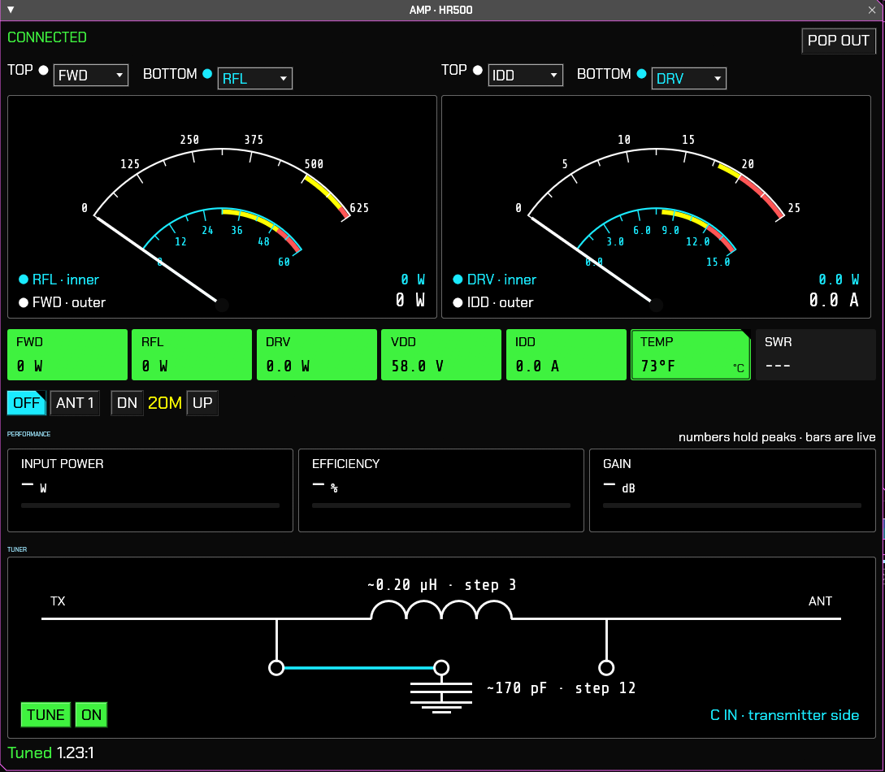

# Hardrock amplifier panel

The AMP window controls and monitors a HobbyPCB Hardrock amplifier over its USB serial port: readings and meters, PTT, antenna and band, and the ATU-500 tuner.

The user manual's section 2.23 describes it in full.

## Tested hardware

**Only the Hardrock-500 has been tested on a real amplifier** (AJ3G, HR500 with VRF2944 output devices and the ATU-500, 115200 baud). Use it with any other model at your own risk.

**Tested on Windows 11 only.** It should work on Linux and macOS, which SDRoxide supports, but it hasn't been tried there.

Maintained by AJ3G.

The Hardrock-50 is selectable, marked "untested", because it shares the HR500's command set. Its meter limits are scaled from the HR500's (no HR50 manual has been checked yet), and its built-in tuner is shown as raw steps. Until it has been tested on real hardware, the readings, warnings or tuner display may be wrong, so keep an eye on the amplifier's own display. The authors plan to test with an HR50.

## Safety

An amplifier this size can damage itself. The panel never switches a relay that may have RF on it. Each such block is marked `SAFETY INTERLOCK` in the code and explained in [safety-interlocks.md](safety-interlocks.md).

## More

- [atu-values.md](atu-values.md): how the tuner's L and C values are estimated.
- [design-decisions.md](design-decisions.md): where the panel deliberately differs from the amplifier, and why.

## Planned: standalone app

The same panel as its own application, without SDRoxide. It has no radio to follow, so it will show a standing notice that band switching is the user's job: switch bands on the panel, or let the rig do it through the amplifier's control interface (as the ELAD does). The band follow inside SDRoxide does not exist there.
